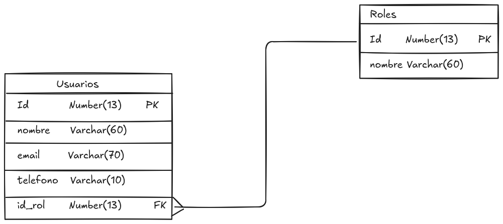

# Ejemplo de creación de tablas

Para ilustrar cómo crear tablas en SQL, vamos a utilizar un ejemplo práctico. Vamos a utilizar el siguiente diagrama relacional completo, que representa una base de datos que almacena usuarios y los roles asignados.

<figure>
  
  <figcaption>Diagrama relacional de usuarios y roles</figcaption>
</figure>

!!! note
    Recuerda que utilizaremos MySQL como sistema gestor de base de datos para este ejemplo, por lo que las sentencias SQL que se presenten estarán adaptadas a este sistema. Además utilizaremos el Software MySQL Workbench para la creación de las tablas y la gestión de la base de datos.

## Creación de la base de datos y utilización de la misma

A la hora de crear tablas, debemos tener en cuenta que deben realizarse en una base de datos (o esquema) específica. Por lo tanto, antes de crear las tablas, debemos crear la base de datos y seleccionarla para su uso.

Es por ello que vamos a crear una base de datos llamada `usuarios_roles` y la seleccionaremos para su uso con las siguientes sentencias SQL:

```sql
CREATE DATABASE usuarios_roles;
```

Es importante que estemos conectados a nuestra instancia local de MySQL y que tengamos los permisos necesarios para crear bases de datos. Una vez creada la base de datos, podemos seleccionarla para su uso con la siguiente sentencia SQL:

```sql
USE usuarios_roles;
```

## Creación de las tablas

Vamos a comenzar por la tabla `Roles`, que almacena información sobre los diferentes roles que pueden tener los usuarios en el sistema.

```sql
CREATE TABLE Roles (
    id INT PRIMARY KEY AUTO_INCREMENT,
    nombre VARCHAR(60) NOT NULL,
);
```

Ahora vamos a representar la tabla `Usuarios`, que almacena información sobre los usuarios de un sistema.

```sql
CREATE TABLE Usuarios (
    id INT PRIMARY KEY AUTO_INCREMENT,
    nombre VARCHAR(100) NOT NULL,
    email VARCHAR(100) UNIQUE NOT NULL,
    id_rol INT,
    CONSTRAINT FK_Usuarios_Roles FOREIGN KEY (id_rol) REFERENCES Roles(id)
);
```

Como vemos en la anterior tabla, hemos definido una clave foránea que hace referencia a la tabla `Roles`, lo que nos permite establecer una relación entre los usuarios y sus roles.

Recuerda que se debe de crear primero la tabla `Roles` antes de crear la tabla `Usuarios`, ya que esta última depende de la primera para establecer la relación.

También es importante mencionar que hemos definido restricciones de integridad, como la restricción `NOT NULL` para los campos `nombre` y `email`, y la restricción `UNIQUE` para el campo `email`, lo que garantiza que no se puedan insertar valores nulos o duplicados en estos campos.

## Revisión de las tablas creadas

Para revisar las tablas creadas, podemos utilizar la siguiente sentencia SQL:

```sql
SHOW TABLES;
```

Además si queremos ver la estructura de una tabla específica, podemos utilizar la siguiente sentencia SQL:

```sql
DESCRIBE Usuarios; -- También se puede utilizar DESC Usuarios;
```

!!! info
    Habrás observado que hemos añadido un comentario utilizando `--` al final de la sentencia SQL. Esto nos permite añadir comentarios en nuestras sentencias SQL para explicar su funcionamiento o cualquier detalle relevante.