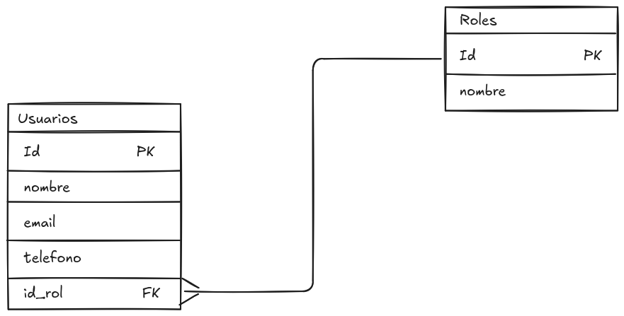

## Diseño de tablas y relaciones

Comenzaremos con el diseño de tablas y relaciones, que es un paso crucial en la implementación de una base de datos relacional. En esta sección, aprenderemos a crear tablas utilizando el diagrama relacional, definir relaciones entre ellas y aplicar restricciones de integridad para garantizar la consistencia de los datos.

Vamos a mostrar el siguiente diagrama relacional de ejemplo:

<figure>
    
    <figcaption>Figura 1: Diagrama Relacional de ejemplo</figcaption>
</figure>

En este diagrama podemos observar 2 tablas: "Usuarios" y "Roles" y una relación entre ellas. La tabla usuarios tiene un atributo "id_rol" que hace referencia a la tabla "Roles". Esta relación indica que cada usuario tiene un rol asignado, y cada rol puede estar asociado a múltiples usuarios.

En este caso, solo se muestran las atributos, claves (PK,UK o FK) y la relación entre las tablas. Sin embargo, no se muestran los dominios de los atributos ni las restricciones de integridad que se aplicarán a la base de datos.

### Diagrama relacional Completo

El diagrama relacional completo también muestra el dominio de los atributos y las restricciones de integridad que se aplicarán a la base de datos. Esto es importante para garantizar que los datos almacenados en la base de datos sean consistentes y cumplan con las reglas de negocio.

EL dominio de los atributos se refiere al tipo de datos que puede almacenar cada atributo, como por ejemplo, si es un número entero, una cadena de texto o una fecha. Las restricciones de integridad son reglas que se aplican a los datos para garantizar su validez y consistencia, como por ejemplo, que un atributo no pueda ser nulo o que un valor sea único en una tabla.

Más adelante, aprenderemos a crear tablas utilizando SQL y a definir relaciones entre ellas, aplicando las restricciones de integridad necesarias para garantizar la consistencia de los datos.

## Dominio de los atributos

Como hemos comentado anteriormente, el dominio de los atributos se refiere al tipo de datos que puede almacenar cada atributo. Es importante definir correctamente el dominio de los atributos para garantizar que los datos almacenados en la base de datos sean válidos y consistentes.

Cada atributo debe tener un tipo de datos específico, como por ejemplo, entero, cadena de texto, fecha, entre otros. Además, es posible definir restricciones adicionales para los atributos, como por ejemplo, que un atributo no pueda ser nulo o que tenga un valor predeterminado.

Un atributo debe tener:

* **Nombre**: El nombre del atributo, que debe ser único dentro de la tabla.
* **Tipo de datos**: El tipo de datos que puede almacenar el atributo, como por ejemplo, entero, cadena de texto, fecha, entre otros.
* **Restricciones**: Reglas adicionales que se aplican al atributo, como por ejemplo, que no pueda ser nulo o que tenga un valor predeterminado.

En el diagrama relacional completo, solo se mostrará el nombre del atributo, el tipo de datos. Esto es suficiente para garantizar la consistencia de los datos almacenados en la base de datos.

Veamos este ejemplo de diagrama relacional completo:

<figure>
    
    <figcaption>Figura 2: Diagrama Relacional Completo de ejemplo</figcaption>
</figure>

En este ejemplo, podemos observar que se han definido los dominios de los atributos y las restricciones de integridad que se aplicarán a la base de datos. Por ejemplo, el atributo "id_usuario" es de tipo entero, mientras que el atributo "nombre" es de tipo cadena de texto.

Algunos de los tipos que se suelen utilizar en SQL son:

* Number: Para almacenar números enteros o decimales. Se indica el número de dígitos y decimales que puede almacenar. Por ejemplo, NUMBER(5,2) permite almacenar números con hasta 5 dígitos en total, de los cuales 2 pueden ser decimales. En caso de ser un número entero, se puede utilizar NUMBER(5) para almacenar números enteros de hasta 5 dígitos.
* Varchar: Para almacenar cadenas de texto de longitud variable. Se indica la longitud máxima de la cadena que puede almacenar. Por ejemplo, VARCHAR(50) permite almacenar cadenas de texto de hasta 50 caracteres.
* Date: Para almacenar fechas en formato de fecha. Por ejemplo, DATE permite almacenar fechas en formato de fecha.
* Boolean: Para almacenar valores booleanos (verdadero o falso). Por ejemplo, BOOLEAN permite almacenar valores booleanos.
* Time: Para almacenar horas en formato de hora. Por ejemplo, TIME permite almacenar horas en formato de hora.

!!! info
    Es importante tener en cuenta que los tipos de datos pueden variar según el sistema de gestión de bases de datos (SGBD) que se esté utilizando. Por lo tanto, es recomendable consultar la documentación del SGBD para conocer los tipos de datos disponibles y sus características específicas.

## Claves

Hemos podido ver que también es importante definir las claves de las tablas, que son atributos o conjuntos de atributos que identifican de manera única cada fila en una tabla. Las claves pueden ser primarias (PK), únicas (UK) o foráneas (FK).

Recordamos que las diferentes claves son:

* **Clave primaria (PK)**: Es un atributo o conjunto de atributos que identifica de manera única cada fila en una tabla. No puede haber dos filas con el mismo valor en la clave primaria y no puede ser nula.
* **Clave única (UK)**: Es un atributo o conjunto de atributos que también identifica de manera única cada fila en una tabla, pero a diferencia de la clave primaria, puede haber varias claves únicas en una tabla. No puede haber dos filas con el mismo valor en la clave única y no puede ser nula.
* **Clave foránea (FK)**: Es un atributo o conjunto de atributos que establece una relación entre dos tablas. La clave foránea hace referencia a la clave primaria de otra tabla, estableciendo así una relación entre ambas tablas. Puede haber varias claves foráneas en una tabla y puede ser nula si no se requiere que todas las filas tengan un valor en la clave foránea.

En una tabla puede haber varias claves únicas y foráneas, pero solo puede haber una clave primaria. Es importante definir correctamente las claves para garantizar la integridad de los datos y establecer relaciones entre las tablas.

En un diagrama relacional completo, se mostrarán las claves de las tablas, indicando cuáles son primarias, únicas o foráneas. Esto es importante para garantizar la consistencia de los datos almacenados en la base de datos y establecer relaciones entre las tablas.

## Restricciones de integridad

Un atributo puede tener restricciones de integridad asociadas, que son reglas que se aplican a los datos para garantizar su validez y consistencia. Las restricciones de integridad pueden ser de varios tipos, como por ejemplo, que un atributo no pueda ser nulo, que tenga un valor predeterminado o que tenga un valor único en una tabla.

En el diagrama relacional, no se suelen establecer las restricciones de integridad, ya que estas se definen en el nivel físico del diseño de bases de datos, cuando se implementa la base de datos en un sistema de gestión de bases de datos (SGBD) utilizando SQL.

Algunas de estas restricciones de integridad que se pueden aplicar a los atributos son:

* **NOT NULL**: Esta restricción indica que un atributo no puede tener un valor nulo. Es decir, cada fila en la tabla debe tener un valor para este atributo.
* **DEFAULT**: Esta restricción permite establecer un valor predeterminado para un atributo. Si no se proporciona un valor al insertar una fila en la tabla, se utilizará el valor predeterminado.
* **UNIQUE**: Esta restricción indica que un atributo debe tener valores únicos en la tabla. No puede haber dos filas con el mismo valor en este atributo.
* **CHECK**: Esta restricción permite definir una condición que debe cumplirse para que un valor sea válido en un atributo. Por ejemplo, se puede establecer que un atributo numérico debe ser mayor que cero.

Ahora mismo, no nos centraremos en estas restricciones de integridad, ya que nos centraremos en la definición de los atributos y sus dominios. Más adelante, cuando aprendamos a crear tablas utilizando SQL, veremos cómo aplicar estas restricciones de integridad para garantizar la consistencia de los datos almacenados en la base de datos.